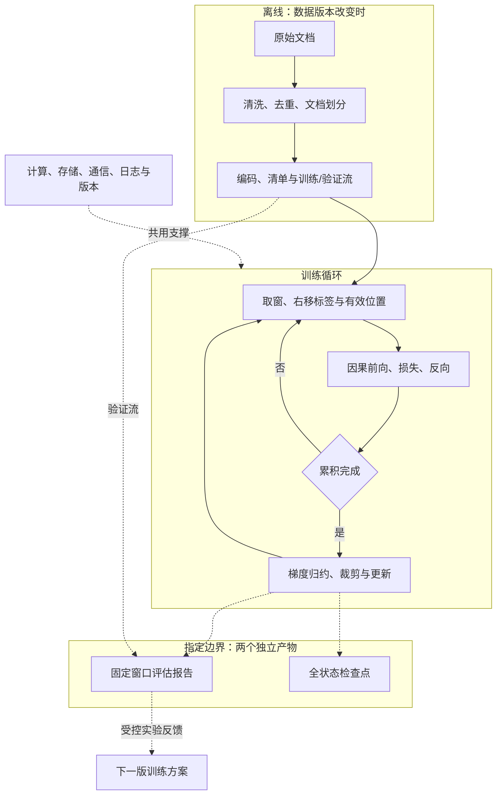

# 《听懂大模型预训练》

从原始文本到模型权重，读懂大模型预训练的原理、系统与工程。

**[在线阅读](https://cjgogo27.github.io/Pretrain/) · [先看章节与架构](https://cjgogo27.github.io/Pretrain/00-reading-guides/00-outline/) · [系统架构源码](src/content/docs/01-system-overview/03-pretraining-system-architecture.mdx)**

参考 CionHuang 的[《“听懂”具身智能——以人形机器人为例》](https://cionhuang.github.io/A_Brief_Tutorial_of_Humanoid_Robot/)的章节组织、场景式解释、角色问答与呈现方式，使用相同的 **Astro + Starlight**。预训练正文、系统图、预算交互和教学实验重新编写；详细归属见 [ATTRIBUTION.md](ATTRIBUTION.md)。

## 目标与内容

让数据、模型、训练、平台和评测说同一套语言，并用一个离线 CPU 小模型贯通训练、验证、检查点和恢复。

| 章节 | 内容 |
| --- | --- |
| 1 系统总览 | 预训练边界、模型部件、从文本到权重的系统架构 |
| 2 数据与分词 | 来源配比、清洗去重、污染、分词、打包、版本验收 |
| 3 模型与计算 | 张量概率、Transformer、位置与上下文、显存计算、预算 |
| 4 优化与分布式 | 梯度累积、AdamW、精度、DDP、状态分片、模型并行、恢复 |
| 5 评估与诊断 | 验证损失、PPL、任务评测、可信比较、吞吐、异常消融 |
| 6 工具与实战 | 工程环境、最小实验、扩卡、持续预训练、交付复现 |
| 导读与附录 | 工程师 / 学生 / 产品路线、术语、配置、预算计算器、参考资料 |

29 个教学小节，每节包含现场问题、三类角色问题、概念与接口表、工程例子、折叠答案和一手参考资料。站点提供中文全文搜索、亮暗主题、左右目录与前后翻页。

## 先看系统



## 本地阅读网站

需要 Node.js 24 与 npm。

```bash
npm ci
npm run check:docs
npm run dev
```

打开终端显示地址下的 `/Pretrain/`。发布构建：

```bash
npm run build
npm run preview
```

章节源文件在 `src/content/docs/`，问答在 `src/data/section-qa.json`。修改章节时同步核对阅读路线、问答和参考来源。

## 跑一次从零预训练

建议使用独立 Python 虚拟环境；验证版本 Python 3.12、PyTorch 2.11 CPU。

```bash
python -m pip install -r examples/requirements.txt
python examples/prepare_data.py --out runs/data
python examples/train.py --data runs/data --out runs/tiny --steps 100
python examples/verify_resume.py
python examples/verify_ddp.py
```

默认模型包含 437,888 个共享权重去重后的可训练参数，使用原创短文本和 UTF-8 单字节词表。示例不下载语料或预训练模型。运行产物保存在忽略的 `runs/` 中。

本轮修订增加真实字节案例、两种 mask、带形状的 block 图、有效 token 加权、DP/TP/PP 布局和[阶段连接导读](https://cjgogo27.github.io/Pretrain/00-reading-guides/04-training-stages/)。[CPU 参考产物](examples/results/cpu-reference.json)包含配置、数据与代码身份、实测 loss 和生成片段。严格恢复检查规范化 train.py 哈希，改代码后拒绝；新阶段可以用 `--init-weights` 只加载权重并重建优化器与计数。

`verify_ddp.py` 使用显式 `TCPStore(use_libuv=False)` 和两进程 Gloo，比较固定样本梯度、一次更新与同一验证集合。它不验证 CUDA、多机、完整 DDP 长跑或生产吞吐。关键引用支持范围见 [SOURCE_AUDIT.md](SOURCE_AUDIT.md)。

它用于机制学习，**不代表通用大模型能力**。预算章节的 1B 模型、20B token 和设备速度均为单独标注的假设。实际检查与限制见 [VALIDATION.md](VALIDATION.md)，示例边界见 [模型卡](examples/MODEL_CARD.md)。

## 发布到 GitHub Pages

仓库已配置 `.github/workflows/pages.yml`：推送 `main` 后检查文档、构建搜索索引并发布。Pages 发布源使用 GitHub Actions；站点 base 固定为 `/Pretrain`。

## 参考与许可

- 文档与教学语料：CC BY-NC-SA 4.0，见 [LICENSE](LICENSE)。
- 站点组件与实验代码：MIT，见 [LICENSE-CODE](LICENSE-CODE)。
- 问答组件适配自 CionHuang 的 MIT 代码，保留原作者版权说明。
- 原教程机器人图片、模型与其他资产未用于本项目。
- 技术来源见各节末尾及[参考资料索引](src/content/docs/07-appendix/d-references.mdx)。
