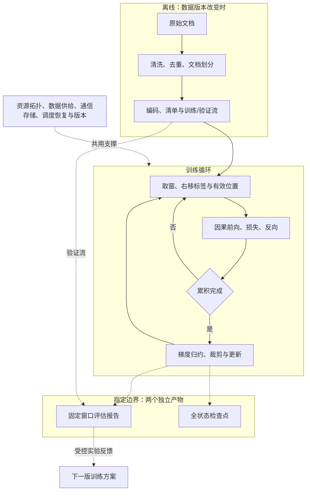

# 《听懂大模型预训练》

从原始文本到模型权重，读懂大模型预训练的原理、系统与工程。

**[在线阅读](https://cjgogo27.github.io/Pretrain/) · [先看章节与架构](https://cjgogo27.github.io/Pretrain/00-reading-guides/00-outline/) · [系统架构源码](src/content/docs/01-system-overview/03-pretraining-system-architecture.mdx)**

参考 CionHuang 的[《“听懂”具身智能——以人形机器人为例》](https://cionhuang.github.io/A_Brief_Tutorial_of_Humanoid_Robot/)的章节组织、场景式解释、角色问答与呈现方式，使用相同的 **Astro + Starlight**。预训练正文、系统图、预算交互和教学实验重新编写；详细归属见 [ATTRIBUTION.md](ATTRIBUTION.md)。

## 目标与内容

预训练核心由数据工程、学习方法与训练Infra共同组成：数据决定学习材料，模型与优化决定怎样学习，基础设施保证供给、执行、通信、资源与状态按计划衔接。用离线CPU小模型贯通训练、验证、检查点与恢复；从[三条主线地图](https://cjgogo27.github.io/Pretrain/00-reading-guides/05-data-and-infrastructure/)进入。

| 章节 | 内容 |
| --- | --- |
| 1 系统总览 | 预训练边界、模型部件、从文本到权重的系统架构 |
| 2 数据与分词 | 来源配比、清洗去重、污染、分词、打包、版本验收 |
| 3 模型与计算 | 张量概率、Transformer、位置与上下文、显存计算、预算 |
| 4 优化与分布式 | 梯度累积、AdamW、精度、DDP、状态分片、五维并行、弹性调度与恢复 |
| 5 评估与诊断 | 验证损失、PPL、任务评测、可信比较、吞吐、异常消融 |
| 6 工具与实战 | 工程环境、最小实验、扩卡、持续预训练、交付复现 |
| 导读与附录 | 工程师 / 学生 / 产品路线、术语、配置、预算计算器、参考资料 |

29 个教学小节，每节包含现场问题、三类角色问题、概念与接口表、工程例子、折叠答案和一手参考资料。站点提供中文全文搜索、亮暗主题、左右目录与前后翻页。

## 先看系统



## 本地阅读网站

需要 Node.js 24 与 npm。

```bash
npm ci
npm run check:docs
npm run dev
```

打开终端显示地址下的 `/Pretrain/`。发布构建：

```bash
npm run build
npm run preview
```

章节源文件在 `src/content/docs/`，问答在 `src/data/section-qa.json`。修改章节时同步核对阅读路线、问答和参考来源。

## 跑一次从零预训练

建议使用独立 Python 虚拟环境；验证版本 Python 3.12、PyTorch 2.11 CPU。

```bash
python -m pip install -r examples/requirements.txt
python examples/prepare_data.py --out runs/data
python examples/train.py --data runs/data --out runs/tiny --steps 100
python examples/verify_resume.py
python examples/verify_ddp.py
python examples/verify_ddp_training.py --out runs/ddp-training
```

默认模型包含 437,888 个共享权重去重后的可训练参数，使用原创短文本和 UTF-8 单字节词表。示例不下载语料或预训练模型。运行产物保存在忽略的 `runs/` 中。

本轮修订增加真实字节案例、两种 mask、带形状的 block 图、有效 token 加权、DP/TP/PP 布局和[阶段连接导读](https://cjgogo27.github.io/Pretrain/00-reading-guides/04-training-stages/)。[CPU 参考产物](examples/results/cpu-reference.json)包含配置、数据与代码身份、实测 loss 和生成片段。严格恢复检查规范化 train.py 哈希，改代码后拒绝；新阶段可以用 `--init-weights` 只加载权重并重建优化器与计数。

`verify_ddp.py` 使用显式 `TCPStore(use_libuv=False)` 和两进程 Gloo，比较固定样本梯度、一次更新与同一验证集合。新增 `verify_ddp_training.py` 比较五次累积/裁剪更新，并调用真实训练循环比较两 rank 八步连续与四步保存后恢复。两者均不验证 CUDA、多机、长期稳定性或生产吞吐。关键引用支持范围见 [SOURCE_AUDIT.md](SOURCE_AUDIT.md)。

它用于机制学习，**不代表通用大模型能力**。预算章节的 1B 模型、20B token 和设备速度均为单独标注的假设。实际检查与限制见 [VALIDATION.md](VALIDATION.md)，示例边界见 [模型卡](examples/MODEL_CARD.md)。

## 三组实跑教学案例

```bash
python examples/cleaning_case.py --out runs/cleaning
python examples/mixture_case.py --out runs/mixture
python examples/parallel_case.py --out runs/parallel
python examples/profile_case.py --out runs/profile
```

依次是带标签清洗误差、三配对种子数据混合、同进程 TP 代数与理想 PP 调度、CPU 受控等待剖析。默认仍离线/CPU；不增加依赖。运行命令、成功条件与边界见对应正文及 [结果说明](examples/results/README.md)。保留六章、29节、87问答；未扩展部署或后训练。

## 发布到 GitHub Pages

仓库已配置 `.github/workflows/pages.yml`：推送 `main` 后检查文档、构建搜索索引并发布。Pages 发布源使用 GitHub Actions；站点 base 固定为 `/Pretrain`。

## 参考与许可

- 文档与教学语料：CC BY-NC-SA 4.0，见 [LICENSE](LICENSE)。
- 站点组件与实验代码：MIT，见 [LICENSE-CODE](LICENSE-CODE)。
- 问答组件适配自 CionHuang 的 MIT 代码，保留原作者版权说明。
- 原教程机器人图片、模型与其他资产未用于本项目。
- 技术来源见各节末尾及[参考资料索引](src/content/docs/07-appendix/d-references.mdx)。

## 数据与Infra修订（2026-10-22）

保留六章29节87问答；补强数据供给/提交游标、资源准入/作业调度、五维并行、MoE路由与负载、状态迁移及端到端成本口径。部署与后训练不扩展。

- 4.5以DP/TP/PP/CP/EP解释5D；32逻辑设备两种层映射、EDP/ETP、131,072原始目标位置可点选核对。EP不是额外乘8倍设备。
- 4.6区分调度器给资源、启动器重建成员、训练运行时恢复状态；解释批量重规划、加载时重分片与随机/数据游标约束。
- 6.3新增独立CPU案例：真实worker退出86，从未变的第2步快照重建，DP2→1→2，384已提交目标位置与基线对照通过。它不是默认train.py的弹性开关，也不是生产集群测试。

```bash
python examples/topology_case.py --out runs/topology
python examples/elastic_case.py --out runs/elastic-case
npm test
```

topology_case仅用Python标准库做逻辑枚举；elastic_case用已有PyTorch、CPU Gloo完整FP64副本、固定随机ID窗口、无dropout，不下载语料/模型。默认严格恢复仍拒绝world size变化。产物与实际限制见[结果索引](examples/results/README.md)和[VALIDATION.md](VALIDATION.md)。

可选浏览器检查入口scripts/check-infra-browser.cjs，先准备Playwright/浏览器并启动本地preview；可通过PLAYWRIGHT_MODULE、BROWSER_EXECUTABLE与BROWSER_CHECK_BASE指定现有运行时和站点。这不是训练依赖。


## 中文 / English

站点页眉的 **English / 中文** 按钮切换当前章节，链接停留在本站；启用JavaScript时同时保留章节锚点。英文阅读、目录导航和折叠问答不需要外部翻译服务。英文版是机器翻译稿，章节标题、常见技术术语与交互提示做了针对性校订，尚未逐句完成专业英文编辑；遇到技术歧义请以中文原文为准。代码块与公式不翻译。

`npm run build` 先生成原有中文页面，再用已提交的 `src/i18n/en.json` 与 `src/i18n/overrides.json` 生成 `/en/` 下的静态页面、语言元数据和搜索索引。生成时不调用翻译服务；中文内容新增或修改而缺少译文会使构建失败，避免把中文冒充英文。英文预览请用 build + preview；开发服务器主要用于中文源文编辑。

维护翻译：先运行 `npm exec astro build` 和 `npm run i18n:collect`，在 `runs/translation-needed.json` 查看新/变更片段；补齐 `en.json` 中对应的 `{zh,en}` 条目（键是源文SHA256前24位），或在 `overrides.json` 中加入人工译文。然后重跑完整构建及 `npm run check:built`。后者逐页核对语言配对、未翻译可见文字、代码/公式一致性和英文角色答案。可选浏览器检查为 `scripts/check-bilingual-browser.cjs`，使用与既有脚本相同的Playwright/浏览器环境变量。
